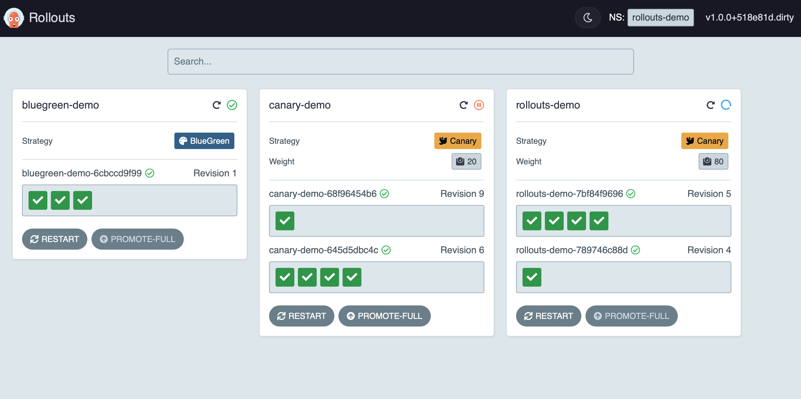
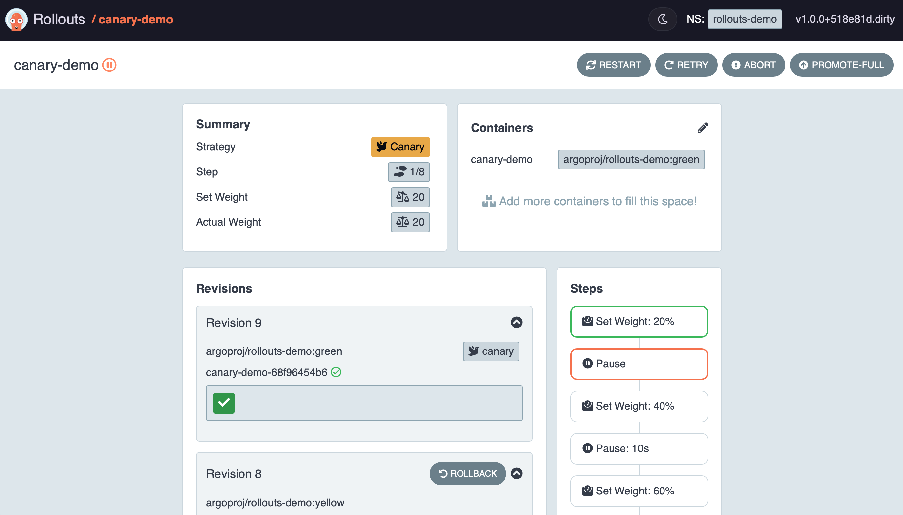

# UI Dashboard

The Argo Rollouts Kubectl plugin can serve a **local** UI Dashboard to visualize your Rollouts.

To start it, run `kubectl argo rollouts dashboard` in the namespace that contains your Rollouts.
Then visit `localhost:3100` to view the user interface.

!!! important
    Available since v1.8.5, v1.9.2, v1.10.1
    
The dashboard server binds to `127.0.0.1` by default instead of
`0.0.0.0`. Pass `--address 0.0.0.0` to the dashboard command to expose the local dashboard in all interfaces to 
bring back the previous behavior.

## List view

## Individual Rollout view

